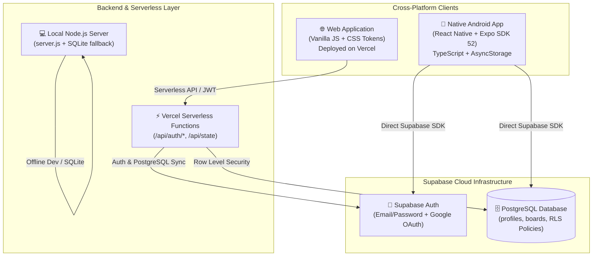

# 🔥 StreakBoard

<div align="center">

**A minimalist, high-performance cross-platform habit tracker, execution planner, and personal life dashboard.**

Available on the **Web** and **Android (Expo)** with instant **Supabase PostgreSQL** cloud sync and offline-first fallback.

[](https://streak-board-mauve.vercel.app)
[](https://supabase.com)
[](https://expo.dev)
[](https://www.typescriptlang.org/)
[](LICENSE)

---

### 🌐 [Launch Live Web App](https://streak-board-mauve.vercel.app) &nbsp;•&nbsp; 📱 [Mobile App Setup](#-mobile-app-expo--android) &nbsp;•&nbsp; 📖 [Documentation](#-architecture)

---

</div>

## 🌟 Overview

StreakBoard is designed for individuals who want an ultra-fast, aesthetically pleasing, and distraction-free system to build habits, plan weeks, and track personal goals.

Whether you're offline on a plane or switching seamlessly between your laptop and Android phone, StreakBoard keeps your progress in sync with end-to-end security and instant response times.

---

## ✨ Features & Modules

### ⚡ 1. Multicolored Habit Tracker
- **8 Coordinated Color Tokens:** Assign distinct, accessible colors to each habit:
  - 🟣 Lavender (`#B6A0F5`)
  - 🔵 Sky Blue (`#7BBBF7`)
  - 🟢 Mint (`#7FD8B2`)
  - 🔴 Coral (`#F39A91`)
  - 🟠 Peach (`#F4BD83`)
  - 🌸 Rose (`#E9A1C0`)
  - 🟡 Lemon (`#E9D779`)
  - 🔷 Teal (`#70CEC8`)
- **Streak Flames & Counters:** Real-time streak tracking with streak preservation logic.
- **Custom Schedules:** Flexible daily or custom recurring schedules with emoji icons.

### 📅 2. Weekly & Monthly Execution
- **Daily Big 3 Priorities:** Lock in your top 3 highest-leverage tasks each day.
- **Monthly Heatmap Grid:** GitHub-style visual consistency heatmaps for the entire month.
- **Boss Tasks & Win Journals:** Celebrate big wins and reflect on daily output.

### 🧠 3. Mindset & Energy Journal
- Monitor daily **energy levels (1-10)**, mental focus, and mood trends.
- Correlate habits with overall well-being over time.

### 💰 4. Personal Budget & Money Tab
- Track monthly recurring bills, essential expenses, and income streams.
- Visualize spending trends alongside your habit consistency.

### 🏆 5. Gamification & XP System
- Gain XP for every habit checked and weekly milestone reached.
- Level up through tiered ranks from Bronze to Gold and Obsidian Master.

### 🔐 6. Cloud Sync with Offline Fallback
- **Supabase Cloud Sync:** Real-time persistence to PostgreSQL with Row Level Security (RLS).
- **Google OAuth & Email Auth:** Password recovery, persistent sessions, and secure token refresh.
- **100% Offline Capable:** If offline or unauthenticated, the app operates locally with full functionality.

---

## 🏗️ Architecture



---

## 📁 Repository Structure

```
StreakBoard/
├── api/                                      # Vercel Serverless Functions
│   ├── auth/                                 # Authentication API routes
│   │   ├── config.js                         # Public configuration endpoint
│   │   ├── signup.js                         # User signup handler
│   │   ├── login.js                          # User login handler
│   │   ├── me.js                             # Session validation handler
│   │   ├── forgot-password.js                # Password recovery email handler
│   │   └── reset-password.js                 # Password update handler
│   ├── state.js                              # Board state sync endpoint
│   └── [...path].js                          # Serverless catch-all handler
├── lib/                                      # Shared server logic
│   ├── api-handler.js                        # Unified router for local & cloud environments
│   └── supabase.js                           # Supabase service layer with SQLite fallback
├── mobile/                                   # Native Android & iOS App (Expo + React Native)
│   ├── src/
│   │   ├── context/                          # AuthContext & BoardContext
│   │   ├── lib/                              # Supabase client, design tokens, types
│   │   └── screens/                          # Today, Week, Profile, & Auth screens
│   ├── App.tsx                               # Mobile application shell
│   ├── app.json                              # Expo app configuration
│   └── eas.json                              # EAS Android APK cloud build profile
├── supabase/                                 # Database migrations
│   └── migrations/
│       └── 20261028000000_init_streakboard.sql # Schema, RLS policies, triggers
├── index.html                                # Web frontend
├── server.js                                 # Local development HTTP server
└── vercel.json                               # Vercel deployment & routing config
```

---

## 🚀 Quick Start (Web)

### 1. Clone the repository
```bash
git clone https://github.com/nalamaditya/StreakBoard.git
cd StreakBoard
```

### 2. Install dependencies
```bash
npm install
```

### 3. Configure environment
Copy `.env.example` to `.env` and fill in your Supabase credentials:
```env
SUPABASE_URL=https://your-project.supabase.co
SUPABASE_ANON_KEY=your-supabase-anon-key
SUPABASE_SERVICE_ROLE_KEY=your-supabase-service-role-key
PORT=3000
NODE_ENV=development
```

### 4. Run locally
```bash
npm start
```
Open **[http://localhost:3000](http://localhost:3000)** in your browser.

---

## 📱 Mobile App (Expo & Android)

The mobile application is located in [`mobile/`](mobile/) and shares the same database and user accounts.

### 1. Start the mobile development server
```bash
cd mobile
npm install
npx expo start
```

### 2. Preview on your Android phone
- Install **Expo Go** from the Google Play Store.
- Scan the terminal QR code or enter your local IP address (e.g. `exp://192.168.x.x:8081`).

### 3. Build Standalone Android APK (EAS Build)
```bash
cd mobile
eas build -p android --profile preview
```
*This produces a direct `.apk` file that can be downloaded and installed on any Android device.*

---

## 🚢 Deploying to Vercel

1. Push your code to GitHub.
2. Import the repository in [Vercel](https://vercel.com).
3. Add the following **Environment Variables** in Vercel:
   - `SUPABASE_URL`
   - `SUPABASE_ANON_KEY`
   - `SUPABASE_SERVICE_ROLE_KEY`
   - `NODE_ENV` = `production`
4. Click **Deploy**. Vercel will deploy both the static frontend and the serverless API routes automatically!

---

## 📄 License

This project is open-source and available under the [MIT License](LICENSE).
